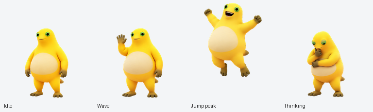
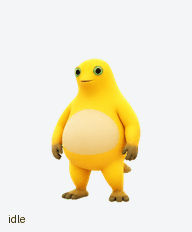
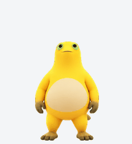
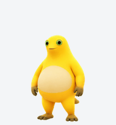

# 奶蛙 · Naiwa 🐸

黄黄的、圆圆的，长着绿眼睛和奶油色肚皮。奶蛙会眨眼、挥手、蹦起来，也会托着下巴认真思考。

为 ChatGPT Work 宠物功能制作的动画伙伴，提供 **9 组动作、16 个视线方向**和可直接导入的透明图集。



## 先看看奶蛙

| 动作预览 | 看向四周 |
| --- | --- |
|  |  |

日常眨眼、向左右移动、挥手、跳跃、失落、等待回应、思考和检查成果，都已经准备好了。



## 下载与使用

**[下载奶蛙 v1.0.0 分享包](https://github.com/AlsoSama/naiwa-pet/releases/download/v1.0.0/naiwa-pet-v1.0.0.zip)** · [查看所有版本](https://github.com/AlsoSama/naiwa-pet/releases)

1. 下载并解压分享包。
2. 在支持 ChatGPT Work 宠物功能、且已启用 **Pets 插件**的聊天中，上传 `assets/naiwa-spritesheet.png`。
3. 复制包内的 **[导入指令.txt](导入指令.txt)** 一并发送，或直接说：

   > 请使用 Pets 插件，把这张现成的 v2 图集导入为名叫“奶蛙”的宠物，并选中它。请复用原图，先验证，通过后创建，不要重新生成动画。

接收方会在自己的账号中获得宠物副本。完整步骤见 **[导入说明](IMPORT.md)**。

也可以单独保存 **[透明图集 PNG](assets/naiwa-spritesheet.png)**。转发时请按文件发送，保留原尺寸和透明背景。

## 图片说明

- **[动作总览](assets/naiwa-contact-sheet.png)**：全部动作与视线姿势，空白格为图集预留位置。
- **[视线方向说明图](assets/naiwa-directions.png)**：正前方参考姿势与十六个方向对照。
- **[MP4 动画预览](assets/naiwa-animations.mp4)**：方便下载播放或转发。

<details>
<summary>图集格式与验证信息</summary>

| 项目 | 参数 |
| --- | --- |
| 文件 | 透明 PNG，RGBA |
| 格式 | Pets v2 |
| 图集尺寸 | 1536 × 2288 |
| 网格 | 8 列 × 11 行 |
| 单格尺寸 | 192 × 208 |
| 动画 | 前 9 行，共 57 帧 |
| 视线 | 后 2 行，共 16 个方向，顺时针排列 |
| 总有效姿势 | 73 |

发布图集已通过结构检查、动作质量检查及三份独立视线复核。参数见 [manifest.json](manifest.json)，文件完整性校验见 [checksums.sha256](checksums.sha256)。

</details>

## 文件内容

```text
naiwa-pet/
├── README.md
├── IMPORT.md
├── 导入指令.txt
├── manifest.json
├── checksums.sha256
└── assets/
    ├── naiwa-spritesheet.png
    ├── naiwa-poses.png
    ├── naiwa-animations.gif
    ├── naiwa-animations.mp4
    ├── naiwa-look-loop.gif
    ├── naiwa-jump.gif
    ├── naiwa-contact-sheet.png
    └── naiwa-directions.png
```
